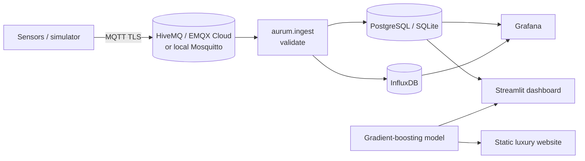

# AURUM · Delhi Parking Forecast

Machine-learning forecasts of how many vehicles will be parked at 12 Delhi landmarks, with a luxury
website, a Streamlit dashboard, a live MQTT → database → Grafana pipeline, Docker packaging and CI/CD.

> **Read this first.** The occupancy data (35,717 readings) comes from 30 car parks in **Birmingham, UK**.
> Each Delhi place borrows the demand pattern of a similar lot and uses an *indicative* capacity.
> Forecasts cover **07:00–17:30** only (the period the data covers). Connect real Delhi sensor data and
> retrain before relying on the numbers. See [docs/MODEL_CARD.md](docs/MODEL_CARD.md).

## Architecture



## Requirements checklist

| Requirement | Where it lives |
|---|---|
| Environment: Python, VS Code/IDE, libraries | `setup_env.sh` / `setup_env.ps1`, `requirements*.txt`, `.vscode/` |
| MQTT: HiveMQ, EMQX Cloud | `aurum/mqtt_io.py`, `aurum/ingest.py`, `aurum/simulator.py`, [docs/MQTT_SETUP.md](docs/MQTT_SETUP.md) |
| Machine learning | `aurum/model.py` (train, evaluate, predict) |
| Datasets | `data/occupancy_birmingham.csv`, `data/parking_sessions.csv`, `data/bay_annotations.xml` (`aurum/vision.py`) |
| Dashboard: Streamlit Cloud | `streamlit_app.py`, `aurum/dashboard.py`, `.streamlit/config.toml` |
| Visualization: Grafana | `grafana/provisioning/` (data sources + dashboard auto-provisioned) |
| Version control: Git | this repository, `.gitignore`, `.gitattributes` |
| GitHub CI/CD | `.github/workflows/` (lint, test, Docker build, publish image, Azure and AWS deploy) |
| Docker | `Dockerfile`, `docker-compose.yml` |
| Databases: SQLite, PostgreSQL, InfluxDB | `aurum/db.py` (SQLite default, PostgreSQL via `DATABASE_URL`), `aurum/influx.py` |
| Cloud: Azure, AWS | `infra/azure/deploy.sh`, `infra/aws/deploy.sh`, [docs/DEPLOYMENT.md](docs/DEPLOYMENT.md) |
| Documentation | this README and `docs/` |
| pytest | `tests/` (26 tests) |
| ruff | `[tool.ruff]` in `pyproject.toml`, enforced in CI |

## Quick start

```bash
# Linux / macOS                         # Windows PowerShell
./setup_env.sh                          .\setup_env.ps1
source .venv/bin/activate               .\.venv\Scripts\Activate.ps1

python -m aurum.simulator --offline --backfill 3    # demo history in SQLite
streamlit run streamlit_app.py                       # http://localhost:8501
```

Dashboard tabs: **Forecast** (type in the destination box to search), **Week** heatmap, **Live**
(sensor readings vs forecast), **Map**, **Camera** (annotated bay images), **Model**.

## Full pipeline with Docker

```bash
cp .env.example .env          # then change every "change-me" value
docker compose --profile demo up -d --build
```

| Service | URL |
|---|---|
| Streamlit dashboard | http://localhost:8501 |
| Grafana (user `admin`) | http://localhost:3000 |
| InfluxDB | http://localhost:8086 |
| Mosquitto (dev broker) | `localhost:1883` |

Drop `--profile demo` when real sensors publish to the broker. To use HiveMQ or EMQX Cloud instead of
the local broker, set the `MQTT_*` values in `.env` ([docs/MQTT_SETUP.md](docs/MQTT_SETUP.md)).

## Development

```bash
pip install -r requirements-dev.txt
ruff check .          # lint
pytest --cov=aurum    # tests
python scripts/build_site.py   # rebuild web/index.html from the model
```

`scripts/browser_audit.py` drives the website in headless Chromium (needs `pip install playwright`
and `playwright install chromium`).

## Project layout

```
aurum/        model, db, mqtt_io, ingest, simulator, influx, vision, dashboard
web/          static luxury website (web/index.html)
data/         datasets
grafana/      provisioning for data sources and the live dashboard
infra/        Azure and AWS setup scripts
docs/         architecture, MQTT, deployment, model card
tests/        pytest suite
```

## Security notes

- Secrets live only in `.env` (git-ignored) or CI secrets. Never commit them.
- The bundled Mosquitto config allows anonymous access: **development only**.
- Incoming MQTT messages are validated (topic, JSON shape, ranges, size) before storage; SQL uses
  parameterised queries.
